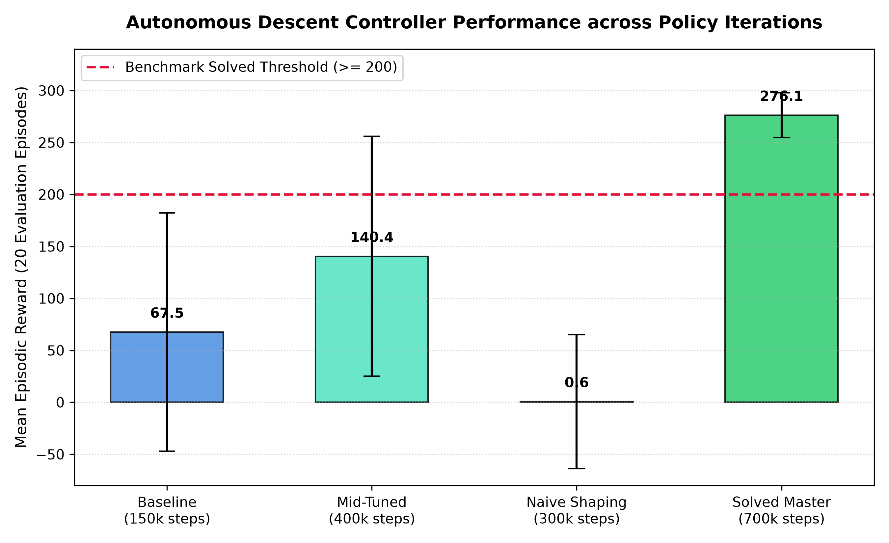

# Autonomous Spacecraft Descent Control (LunarLander-v3)

[](https://www.python.org/downloads/)
[](https://gymnasium.farama.org/)
[](https://stable-baselines3.readthedocs.io/)
[](#benchmark-performance)

An autonomous spacecraft descent controller trained using Deep Reinforcement Learning (DRL) in Farama Gymnasium's Box2D rigid-body dynamics environment. Instead of classical PID or LQR flight controllers, an AI policy learns closed-loop attitude stabilization, thrust modulation, and soft touchdown dynamics using **Proximal Policy Optimization (PPO)**.

---

## Benchmark Performance

The official solve criteria for `LunarLander-v3` requires a 100-episode mean return $\ge +200$. The final master policy converged to **$276.15 \pm 21.50$** across 20 randomized evaluation seeds, significantly exceeding the benchmark.



### Quantitative Progression Across Iterations

| Run Configuration | Timesteps | Mean Reward (20 Episodes) | Standard Deviation ($\sigma$) | Observed Behavior & Flight Mechanics |
| :--- | :---: | :---: | :---: | :--- |
| **Baseline PPO** | 150,000 | 67.55 | $\pm 114.51$ | Basic attitude control; high impact rate (~60% touchdown rate). |
| **Extended Rollouts (Mid-Tuned)** | 400,000 | 140.45 | $\pm 115.40$ | Controlled descent velocity; lands on outer terrain edges; misses central pad flags. |
| **Naive Reward Shaping** | 300,000 | 0.63 | $\pm 64.51$ | **Reward Hacking Trap:** Agent aborts flight prematurely to minimize accumulated penalties. |
| **Solved Master Policy** | 700,000 | **276.15** | **$\pm 21.50$** | **Solved ($\ge 200$):** Precision descent, active angular damping, smooth upright touchdown between flags. |

---

## Technical Case Study: The Reward Hacking Trap

To discourage horizontal drift and eliminate off-pad landings, a custom Gymnasium `RewardWrapper` was implemented in `train_shaped.py`:

$$R'_t = R_t - 0.5 \cdot \vert{}x_t\vert{} - 0.3 \cdot \vert{}\theta_t\vert{} - 0.4 \cdot \vert{}v_{x,t}\vert{}$$

### Why It Failed
Episodes span 400–800 simulation frames. The negative per-frame penalty accumulated to between $-150$ and $-300$ points simply for hovering and stabilizing. Optimization gradients drove the policy to crash or terminate descent as rapidly as possible to limit cumulative loss, dropping performance to a mean of **0.63**.

### Solution
Dense rewards must satisfy **Potential-Based Reward Shaping (PBRS)** principles ($F(s, s') = \gamma \Phi(s') - \Phi(s)$) to preserve optimal policy invariance. Native quadratic potential formulation coupled with scaled rollout trajectories ($N_{\text{steps}} = 2048$, $700\text{k}$ steps) successfully eliminated policy oscillation.

---

## System Architecture

* **State Space ($S \in \mathbb{R}^8$):** Horizontal position ($x$), vertical position ($y$), linear velocities ($v_x, v_y$), lander angle ($\theta$), angular velocity ($\omega$), and bilateral leg ground-contact flags ($c_L, c_R$).
* **Action Space ($A \in \{0, 1, 2, 3\}$):** Discrete control `[0: Do Nothing, 1: Fire Left Thruster, 2: Fire Main Engine, 3: Fire Right Thruster]`.
* **Algorithm:** Proximal Policy Optimization (PPO) using an Actor-Critic Multi-Layer Perceptron (`MlpPolicy`) with Generalized Advantage Estimation ($\gamma=0.99$, $\lambda=0.98$).

---

## Project Structure

```text
Lunar_lander_ml/
├── convergence_comparison.png       # Publication-ready 300 DPI benchmark chart
├── plot_results.py                  # Headless Matplotlib visualization script
├── test_env.py                      # Box2D dependency & observation sanity check
├── train.py                         # Baseline & mid-tuned PPO training pipeline
├── train_shaped.py                  # Custom RewardWrapper experiment (reward hacking)
├── train_final.py                   # Master benchmark-solving model training script
├── visualize.py                     # Interactive 60 FPS Pygame physical simulation
├── ppo_lunar_lander_master.zip      # Trained model weights (276.15 benchmark)
├── requirements.txt                 # Pinned dependencies
└── README.md
```

---

## Quickstart & Execution

### 1. Environment Setup
```bash
git clone [https://github.com/nischith-bv/Lunar_Lander_ml.git](https://github.com/nischith-bv/Lunar_Lander_ml.git)
cd Lunar_Lander_ml
pip install "gymnasium[box2d]" stable-baselines3 torch matplotlib
```

### 2. Run the Visualizer
To watch the pre-trained master policy execute autonomous landing in real time:
```bash
python visualize.py
```

### 3. Reproduce Training or Plots
* Re-run headless benchmark chart generation:
  ```bash
  python plot_results.py
  ```
* Re-train the master policy from scratch:
  ```bash
  python train_final.py
  ```